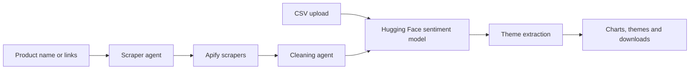

# 📊 Feedback Sentiment Analyser

A Streamlit app that shows how customers feel about a product, and why. Upload a CSV of reviews, or name a product and let AI agents collect and clean feedback from Amazon, eBay and TikTok.

## What it does

1. **Collect:** upload a CSV, or enter a product name or links and choose your platforms.
2. **Clean:** feedback from each source is reduced to one table of platform, text, date and rating.
3. **Analyse:** press **Analyse sentiment** to label each review Positive, Neutral or Negative.
4. **Explore:** see the overall split, the themes behind each sentiment, and the trend over time.

### Outputs

| Output | Description |
|---|---|
| Sentiment results table | Each review with its label, plus platform and rating for scraped data |
| Pie chart | Overall share of each sentiment |
| Theme panels | Up to 6 themes per sentiment, each with a review count, share and real quote |
| Trend chart | Sentiment by month, when a date is available |
| CSV downloads | Cleaned data and labelled results, formatted to open correctly in Excel |

## How it works



- **Scraper agent:** Claude finds product listings with web search, finds relevant TikTok videos, and calls an Apify scraper for each platform. It sees row counts and column names rather than the scraped rows.
- **Cleaning agent:** Claude sees only each table's column names and 5 sample values, then identifies the text, title, date and rating columns. pandas applies that mapping to every row, normalises dates and ratings, and removes empty rows, exact duplicates and non-English text.
- **Sentiment model:** [`cardiffnlp/twitter-roberta-base-sentiment`](https://huggingface.co/cardiffnlp/twitter-roberta-base-sentiment) runs through the Hugging Face Inference API, with parallel requests and retries.
- **Theme extraction:** Claude assigns reviews to themes by ID using structured output. The app then does the counting and takes each quote word for word from those reviews. Above 300 reviews in a sentiment group, it uses a random sample and says so.

Amazon and eBay reviews are requested newest first, across all star ratings, to avoid the skew of "top reviews" or per-star sampling.

## Getting started

Requires Python 3.11 or later.

```bash
git clone https://github.com/SparklingTea/feedback_sentiment_analyzer.git
cd feedback_sentiment_analyzer
pip install -r requirements.txt
```

Create `.streamlit/secrets.toml` and keep it out of version control:

```toml
HF_TOKEN = "hf_..."
ANTHROPIC_API_KEY = "sk-ant-..."
APIFY_TOKEN = "apify_api_..."
```

| Secret | Used for | Required for |
|---|---|---|
| `HF_TOKEN` | Sentiment classification | Always. The app won't start without it. |
| `ANTHROPIC_API_KEY` | Agents and theme extraction | Scraping. Without it, CSV analysis falls back to simple word lists instead of themes. |
| `APIFY_TOKEN` | Running the scrapers | Scraping |

Then run the app:

```bash
streamlit run app.py
```

To deploy on [Streamlit Community Cloud](https://streamlit.io/cloud), point it at `app.py` and paste the same values into the app's **Secrets** settings. Reboot the app after changing any file other than `app.py`, so it loads the new code.

## Costs and limits

All three services are billed to your own accounts, and prices can change.

- **Hugging Face:** free accounts have no monthly inference credits, so you need prepaid credits or a PRO plan.
- **Apify:** usage is billed per result. Each scraper run is capped at $5 by the app. The Amazon scraper limits free-plan users to 1 product and 10 reviews per run, so larger samples need a paid plan.
- **Anthropic:** billed per token for the agents and theme extraction.
- **Amazon:** expect about 100 of the newest reviews per listing. For larger requests, the agent can use up to 3 listings of the same product.
- **Language:** the sentiment model works on English text. Very short non-English comments can get past the filter, because they can't be identified reliably.
- **Reliability:** scrapers depend on third-party sites and can break when those sites change.

## Project structure

| File | Purpose |
|---|---|
| `app.py` | Streamlit interface and overall flow |
| `scraper_agent.py` | Scraper agent and Apify integration |
| `cleaner_agent.py` | Column mapping, normalisation and filtering |
| `analyzer.py` | Sentiment classification |
| `insights.py` | Theme extraction |
| `visualizer.py` | Charts and fallback word lists |
| `Datafiniti_Amazon_Consumer_Reviews_of_Amazon_Products.csv` | [Sample Amazon reviews from Kaggle](https://www.kaggle.com/datasets/datafiniti/consumer-reviews-of-amazon-products). Take a small sample first, because each row is one paid API request. |

## Responsible use

Check that your use complies with each platform's terms and applicable data protection law. The app doesn't ask the scrapers for personal reviewer data, but scraped results can still contain usernames, so handle them with care.
